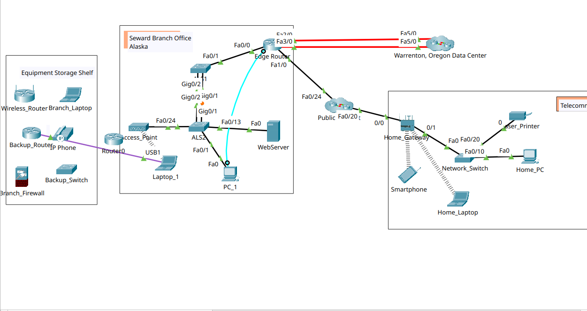
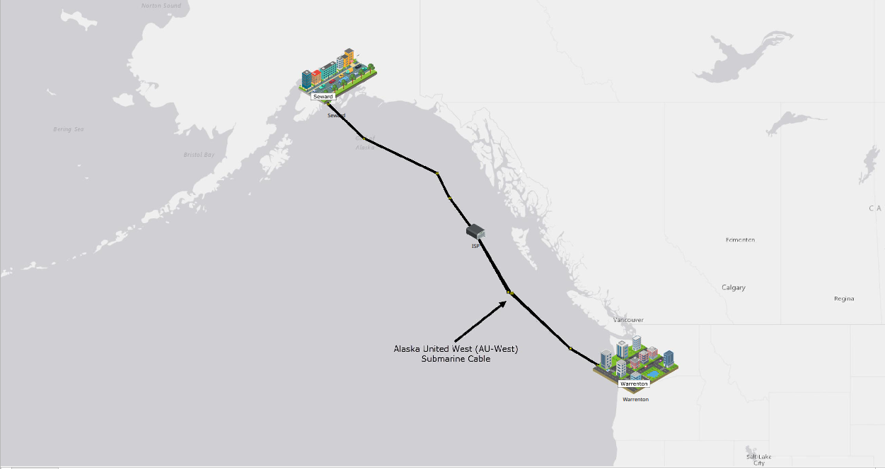
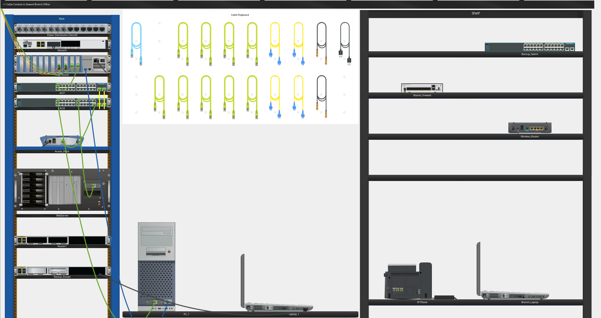
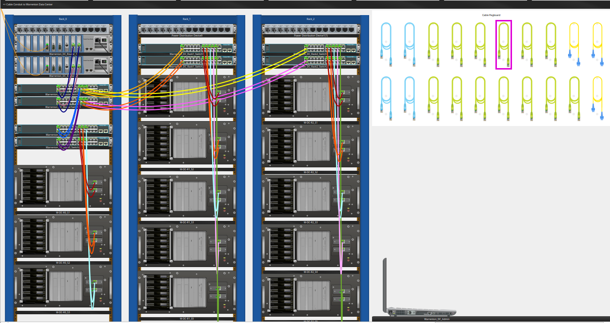
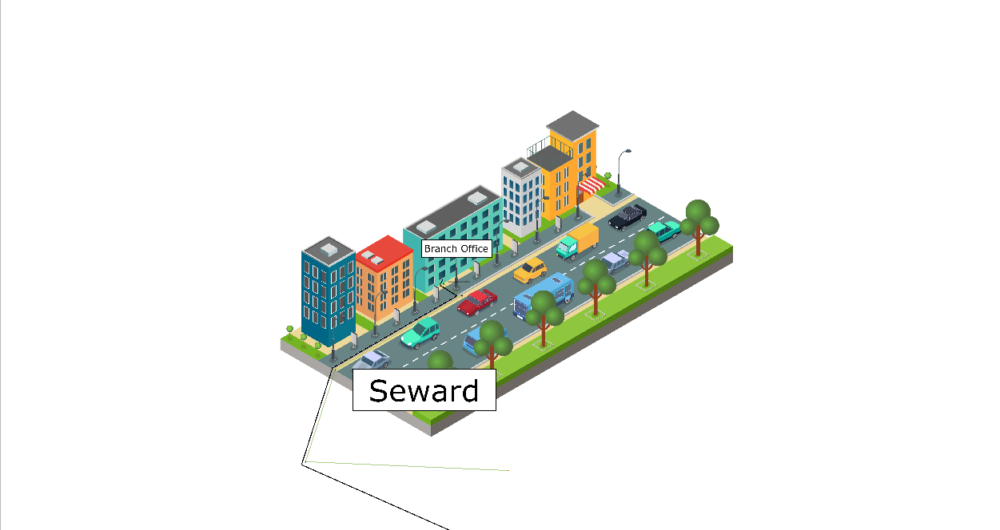

# Lab 01: Logical and Physical Mode Exploration

**Tool:** Cisco Packet Tracer

## Objective
To understand how the Logical and Physical workspaces work in Packet Tracer by exploring a realistic network made up of a Seward Branch Office (Alaska), a Warrenton Data Center (Oregon), and a Home Telecommuter site.

## Topics Covered
- Logical vs Physical workspace
- Routers, switches, and access points
- Copper straight-through and console connections
- USB console connection

## Screenshots

### Logical mode

The full network topology: Seward Branch Office, Warrenton Data Center, the public network, and the Home Telecommuter. Devices and interfaces (such as Fa0/0 and Gig0/1) are visible, but their physical locations are not.

### Physical mode: geographic map

Seward (Alaska) and Warrenton (Oregon) connected by the AU-West submarine cable, with an ISP in between.

### Branch office rack

Inside the Branch Office wiring closet: routers, switches (ALS1, ALS2), an access point, a web server, and the cable pegboard.

### Data center racks

Three racks in the Warrenton Data Center with routers, switches, and servers connected by color-coded cables.

### City view

The city-level view in Physical mode. From here you can drill down to a building, then a wiring closet, then a rack.

## Key Learnings
- **Logical mode** shows how devices are connected to each other. It is where topologies are built and configured. **Physical mode** shows where those devices actually sit: which city, building, and rack.
- Physical mode follows a hierarchy: Intercity, City, Building, Wiring Closet, Rack. This shows how real networks are organized.
- Different cables serve different purposes. A **copper straight-through** cable usually connects unlike devices (for example, a PC to a switch). A **console cable** gives direct CLI access to a router or switch without using the network.
- With a **USB console connection**, a PC connects to the device's console port through USB and manages it using a terminal.

## Challenges
No major problems in this lab, since it mainly introduces the tool. The only slow part was navigating the Physical mode hierarchy and finding which device sits in which rack. I solved it by drilling down level by level and matching device names against the Logical view.
