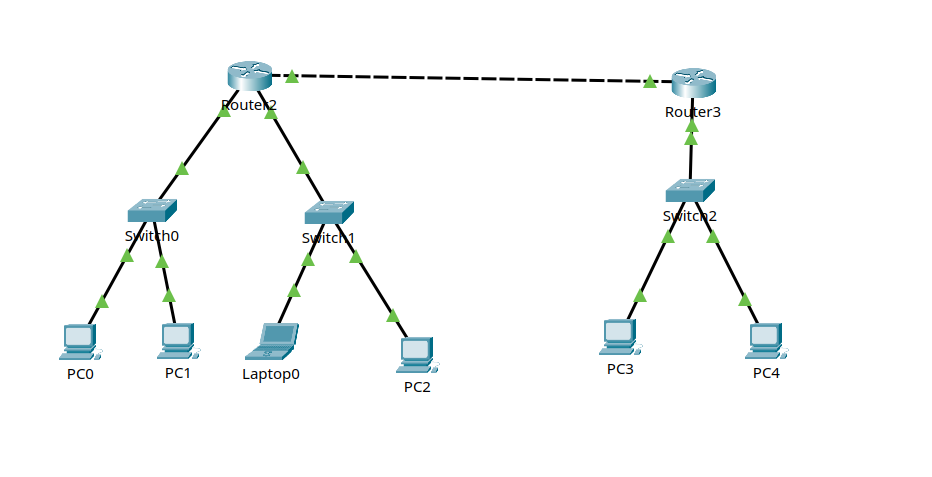
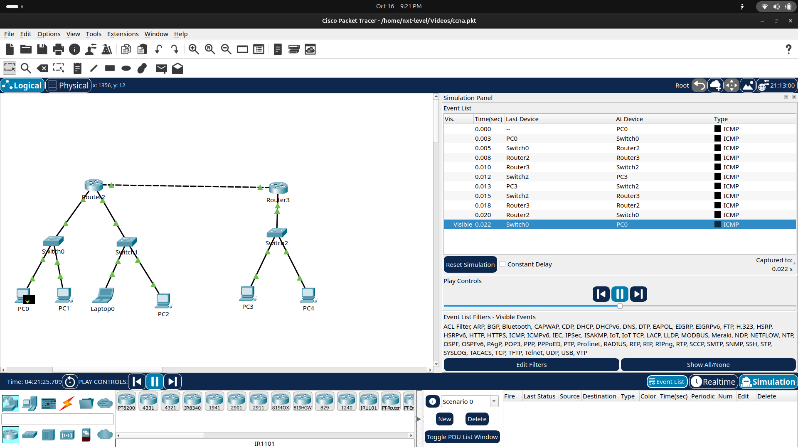

# 1.5.5 Packet Tracer - Network Representation

## Overview

This lab explores a small business network in Cisco Packet Tracer and introduces the common building blocks of a network: end devices, intermediary devices, media, LANs, and WANs.

After exploring the provided topology, I completed the challenge by building my own network from scratch: **three LANs connected by two routers over a WAN link, using static routing.** I then verified end-to-end connectivity with `ping` and watched the packets travel hop by hop in Simulation mode.

## Objectives

- Identify common network components as represented in Packet Tracer.
- Understand the purpose of end devices, intermediary devices, and network media.
- Compare LANs and WANs.
- Build and verify a multi-LAN network connected through a WAN link.

## Tools

- Cisco Packet Tracer
- Linux and Git for version control

## What I Observed in the Provided Topology

- The network has three sites (Home Office, Central, Branch), each one a separate **LAN**. Internet and Intranet clouds connect them, and those links are **WANs**.
- **End devices** sit at the edge of the network and have a single connection: PCs, laptops, printers, servers, phones, tablets.
- **Intermediary devices** have several connections and move traffic between devices: switches, routers, access points, modems.
- Several **media types** are used: copper (straight-through), serial (WAN links), coaxial, and wireless.

## Challenge: Two LANs Connected by a WAN

Project file: [`02-two-lans-one-wan.pkt`](02-two-lans-one-wan.pkt)

### Topology



```
PC0, PC1 --- Switch0 ---\
                         R2 ========== R3 --- Switch2 --- PC3, PC4
Laptop0, PC2 - Switch1 -/
```

### IP Addressing Plan

| Network | Subnet | Gateway |
|---|---|---|
| LAN A (PC0, PC1) | 192.168.1.0/24 | 192.168.1.1 (R2 g0/0) |
| LAN B (Laptop0, PC2) | 192.168.2.0/24 | 192.168.2.1 (R2 g0/1) |
| LAN C (PC3, PC4) | 192.168.3.0/24 | 192.168.3.1 (R3 g0/0) |
| WAN link (R2 - R3) | 10.0.0.0/30 | R2 g0/2 = 10.0.0.1, R3 g0/1 = 10.0.0.2 |

| Device | IP Address | Default Gateway |
|---|---|---|
| PC0 | 192.168.1.10 | 192.168.1.1 |
| PC1 | 192.168.1.11 | 192.168.1.1 |
| Laptop0 | 192.168.2.10 | 192.168.2.1 |
| PC2 | 192.168.2.11 | 192.168.2.1 |
| PC3 | 192.168.3.10 | 192.168.3.1 |
| PC4 | 192.168.3.11 | 192.168.3.1 |

Subnet mask on all end devices: `255.255.255.0`.

### Router Configuration

**R2**

```
enable
configure terminal
hostname R2
interface g0/0
 ip address 192.168.1.1 255.255.255.0
 no shutdown
interface g0/1
 ip address 192.168.2.1 255.255.255.0
 no shutdown
interface g0/2
 ip address 10.0.0.1 255.255.255.252
 no shutdown
exit
ip route 192.168.3.0 255.255.255.0 10.0.0.2
end
copy running-config startup-config
```

**R3**

```
enable
configure terminal
hostname R3
interface g0/0
 ip address 192.168.3.1 255.255.255.0
 no shutdown
interface g0/1
 ip address 10.0.0.2 255.255.255.252
 no shutdown
exit
ip route 192.168.1.0 255.255.255.0 10.0.0.1
ip route 192.168.2.0 255.255.255.0 10.0.0.1
end
copy running-config startup-config
```

### What the Commands Do

| Command | Purpose |
|---|---|
| `hostname R2` | Names the device so the prompt is easy to recognize |
| `interface g0/0` | Selects the port to configure |
| `ip address ...` | Assigns an IP address and subnet mask to the port |
| `no shutdown` | Turns the port on (router ports are off by default) |
| `ip route <network> <mask> <next hop>` | Adds a static route: "to reach this network, send traffic to this next hop" |
| `copy running-config startup-config` | Saves the configuration so it survives a reboot |
| `show ip interface brief` | Quickly checks the IP address and state of every port |

### Verification

`ping` from PC0 to PC3 (a different LAN, across the WAN link) succeeds with **TTL=126**.

Windows devices start with TTL 128 and every router decreases it by 1, so 126 confirms that exactly two routers (R2 and R3) were crossed. A ping to a device in the neighbouring LAN (Laptop0) shows TTL=127, which means one router (R2) was crossed. A ping to the gateway itself shows TTL=255, because the reply comes directly from the router.

The first packet or two of a ping can time out. This is expected while devices learn each other's MAC addresses (ARP) for the first time. Later packets succeed.

### Packet Journey in Simulation Mode

I used Simulation mode to follow a ping from PC0 to PC3 and back:



```
PC0 -> Switch0 -> R2 -> R3 -> Switch2 -> PC3   (ICMP echo request)
PC3 -> Switch2 -> R3 -> R2 -> Switch0 -> PC0   (ICMP echo reply)
```

1. PC0 sees that 192.168.3.10 is not in its own network, so it sends the packet to its default gateway (R2).
2. Switch0 forwards the frame using MAC addresses only. A switch does not look at IP addresses.
3. R2 checks its routing table: `192.168.3.0/24` is reachable via `10.0.0.2`, so it forwards the packet to R3 and decreases the TTL.
4. R3 sees that the destination is in its own directly connected network and delivers the packet through Switch2 to PC3.
5. The reply returns along the same path. This is why R3 also needs routes back to the other LANs.

## Key Learnings

- **Switches vs routers:** switches move traffic inside one LAN using MAC addresses; routers move traffic between different networks using IP addresses.
- **Default gateway:** an end device sends all traffic for other networks to its gateway. A wrong or missing gateway breaks communication outside the LAN.
- **Static routes:** a router only knows its directly connected networks. Routes to remote networks must be added, and they are needed in **both directions**, otherwise replies cannot return.
- **Router ports are off by default:** `no shutdown` is required on every router interface in use.
- **TTL** shows how many routers a packet crossed.
- **Client-server model:** a client requests a service and a server provides it. In Packet Tracer only the Server-PT device can act as a server.
- **Intermediary devices** connect networks, forward traffic, and can filter it (firewalls).
- **Choosing media:** consider distance, installation environment, required bandwidth, and cost.
- **LAN vs WAN:** a LAN covers a small area under one organization; a WAN connects LANs over large distances, often using a service provider.

## Challenges Faced

- **Router stuck at the ROMMON prompt:** the first router model I used did not boot into IOS. The prompt showed `>` and `enable` was not recognized. I replaced both routers with a model that boots normally and re-cabled the topology.
- **Interface names:** I checked the real port names with `show ip interface brief` before configuring, instead of assuming them.
- **Typo in ping:** I typed `192.1688.1.1` and got "could not find host". This was a typing mistake, not a network problem.
- **Red link lights on routers:** these were expected because router ports start shut down. They turned green after `no shutdown`.

## Note

The lab instructions and original activity files belong to Cisco Networking Academy and are not included here. This folder contains only my own screenshots, configuration, and notes.
